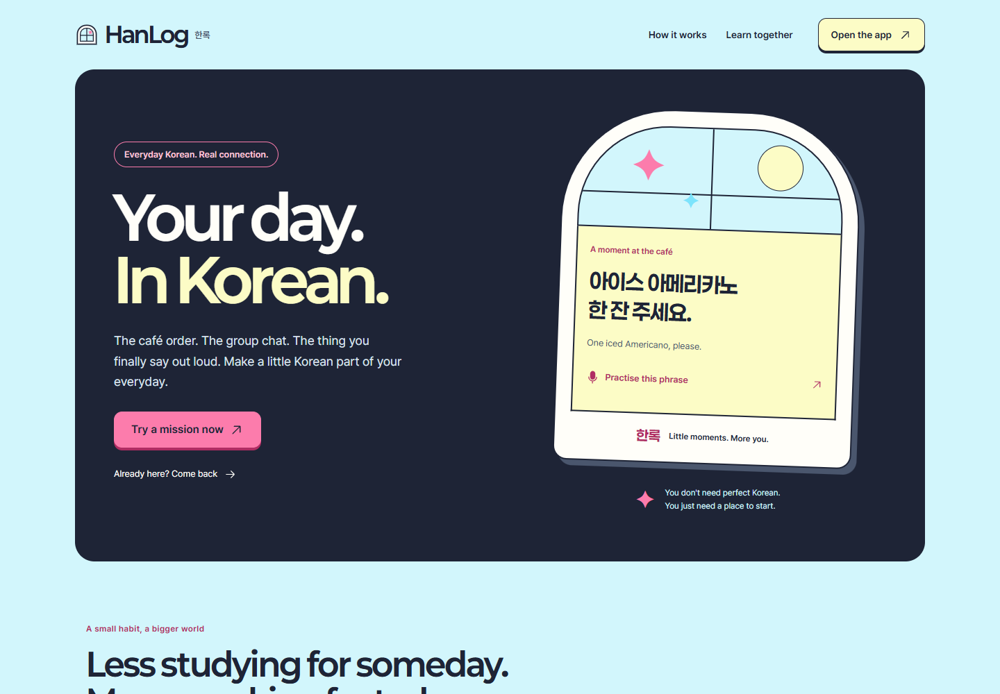
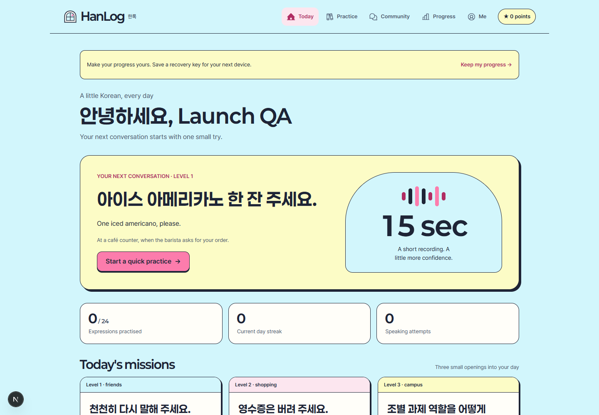
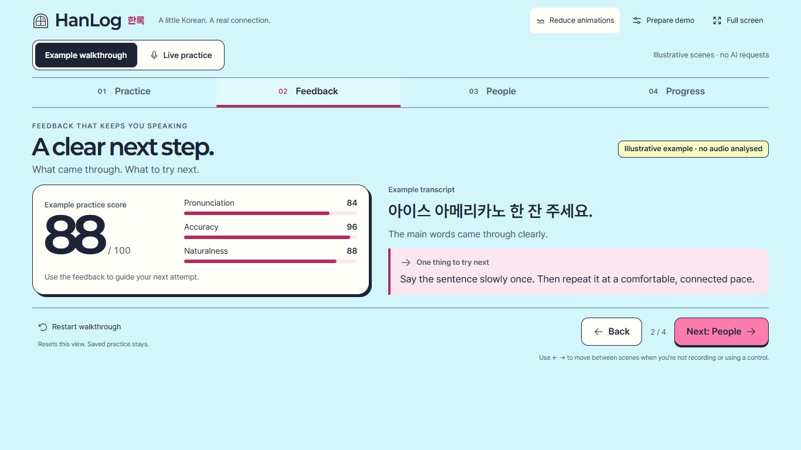
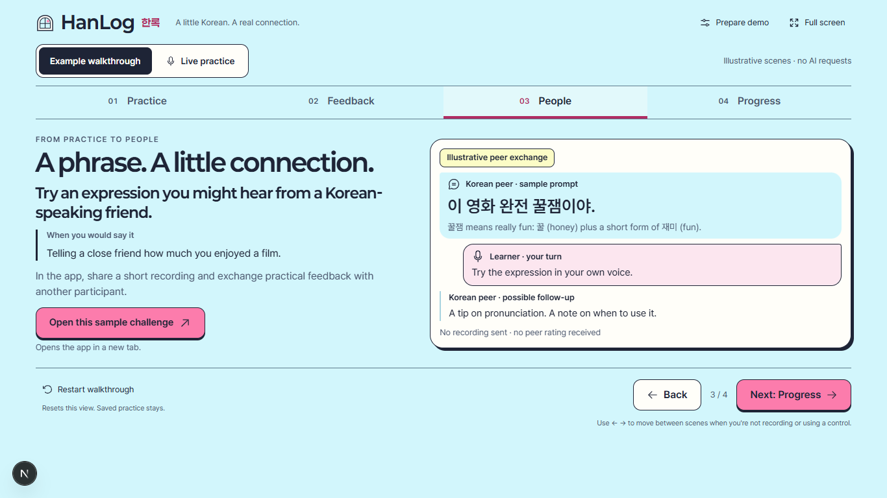
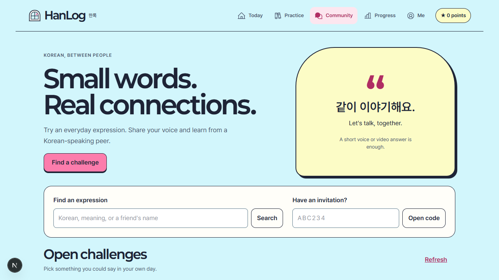
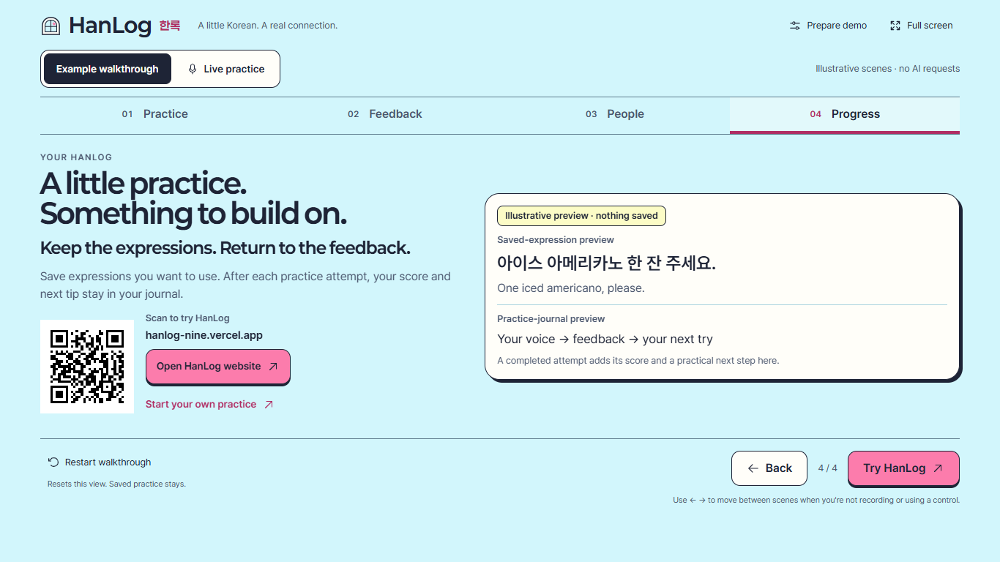
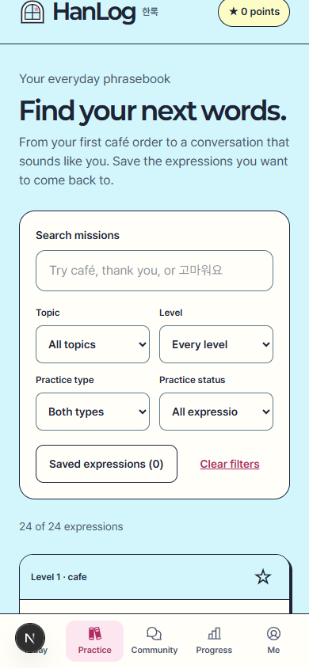
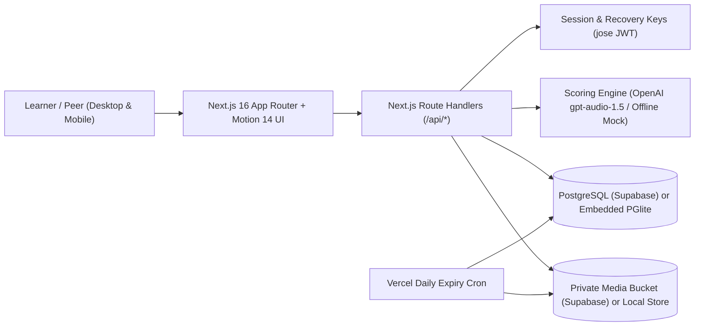

# HanLog · 한록

**An AI-powered Korean speaking practice & peer-challenge web application.**

**Live Public Beta:** [hanlog-nine.vercel.app](https://hanlog-nine.vercel.app) · **Interactive Walkthrough:** [hanlog-nine.vercel.app/demo](https://hanlog-nine.vercel.app/demo)

Built with **Next.js 16.4 (App Router)**, **React 19**, **TypeScript**, **Tailwind CSS 4**, **Motion 14**, **OpenAI Audio (`gpt-audio-1.5`)**, **PGlite / PostgreSQL (Supabase)**, and **Playwright + Vitest**. HanLog helps learners go from everyday Korean phrases to spoken confidence through 15-second voice/video missions, structured AI pronunciation feedback, and asynchronous peer exchanges—without requiring email/password sign-up.

---

## Key Highlights for Reviewers

- **Live Production Beta & Interactive Demo Mode:** Deployed on Vercel (`icn1` Seoul region) with Supabase PostgreSQL + private object storage, plus a zero-config local demo launcher (`npm run demo`) backed by embedded **PGlite** and offline mock scoring.
- **Audio AI Feedback & Jamo-Aware Scoring Pipeline:** Browser-side audio conversion (`mediabunny` + WAV encoder), magic-byte media validation, OpenAI `gpt-audio-1.5` scoring across *Pronunciation*, *Accuracy*, and *Naturalness*, and deterministic per-user/IP/global rate limits.
- **Passwordless Privacy-First Identity:** Browser-session accounts signed with `jose` JWTs, one-time rotatable recovery keys (only hashes stored), full JSON data export, sign-out everywhere, and complete account/media deletion.
- **Open Window Design System & Accessibility:** Custom Navy / Sky / Buttercream / Pink visual system with local Paperlogy & Pretendard fonts, reduced-motion controls, and `@axe-core/playwright` accessibility verification.
- **Comprehensive Verification Suite:** **129 test & fixture files** across API (`22`), Unit (`32`), UI (`41`), and Playwright E2E (`16`), plus a CI bundle-leak guard (`scripts/check-bundle.mjs`) ensuring zero server secrets enter `.next/static`.

---

## UI Showcase

### 1. Landing Experience & Daily Mission Dashboard
| Landing Page (`Open Window` Design System) | Today Dashboard & 15s Speaking Prompt |
| :---: | :---: |
|  |  |
| *Warm editorial hero featuring everyday Korean phrases (`아이스 아메리카노 한 잔 주세요.`).* | *Daily mission card, streak/attempts counters, recovery-key reminder, and level-tagged tasks.* |

### 2. AI Speech Feedback & Peer Exchange
| Structured AI Feedback (0–100 + Next Step) | Korean-Speaker Peer Challenge |
| :---: | :---: |
|  |  |
| *Scored breakdown across Pronunciation, Accuracy, and Naturalness with transcript & concrete tip.* | *Asynchronous voice/video exchange with contextual cultural notes and peer tips.* |

### 3. Community Challenges, Progress Walkthrough & Mobile Phrasebook
| Community Search & Invite Codes | Progress Journal & Live QR Mode | Mobile Phrasebook (24 Missions) |
| :---: | :---: | :---: |
|  |  |  |
| *Search expressions or join private challenges via rate-limited invite codes.* | *Saved expressions, practice journal, and audience QR walkthrough (`/demo`).* | *Mobile-first filtering by topic, level, and status across 24 missions.* |

---

## Core Features

### 1. Speaking Missions & Phrasebook (`/app/missions`)
- **24 searchable everyday missions** organized by topic, difficulty level, and practice status, with bookmarkable saved expressions and a personal practice journal (`/app/progress`).
- **In-browser recording & media inspection:** Records voice/video directly in the browser, converts audio to WAV (`src/lib/audio/to-wav.ts`), and enforces server-side magic-byte/MIME inspection (`src/lib/media/sniff.ts`, `jpeg.ts`) before persistence.

### 2. AI Speech Scoring (`src/lib/scoring/`)
- **Live provider (`SCORING_PROVIDER=openai`):** Server-only `OPENAI_API_KEY` calls `gpt-audio-1.5` to produce a transcript, *Pronunciation / Accuracy / Naturalness* sub-scores, Jamo/speech analysis (`jamo.ts`), and one actionable next step.
- **Offline Demo / CI provider (`SCORING_PROVIDER=mock`):** Deterministic scoring with clearly labeled example/mock badges so reviewers and tests never trigger paid API calls unintentionally.
- **Cost & Abuse Guardrails:** Production enforces daily caps (30 calls/user, 100/IP, 100 globally per KST day) with failed-call reservation accounting.

### 3. Peer Challenges, Groups & Community Moderation (`/app/challenges`, `/app/groups`, `/app/feed`)
- **Asynchronous peer feedback:** Learners record and exchange audio/video responses and ratings (`Stars`, written tips) with Korean-speaking peers.
- **Private Groups & Invite Codes:** Rate-limited join-code verification preventing brute-force guessing (`0adf21b`).
- **Community Safety:** Automated nickname moderation, per-user daily report caps, instant hide-on-report for reported items, and an operator CLI (`scripts/review-community-reports.ts`) with dry-run defaults.

### 4. Passwordless Profiles & Data Portability (`/app/me`)
- **Zero-friction onboarding:** Starts in a signed browser session; learners can generate a private **recovery key** (stored hashed only) to restore their profile on another device with automatic key rotation and prior-session invalidation.
- **GDPR-style user controls:** One-click JSON data export, key replacement, sign-out everywhere, and full account + recording deletion.

---

## Architecture & Tech Stack



| Layer | Technologies |
| :--- | :--- |
| **Frontend** | Next.js `16.4.6` (App Router), React `19.3`, TypeScript `5`, Tailwind CSS `4`, Motion `14.14`, `@phosphor-icons/react`, Paperlogy & Pretendard local fonts |
| **Backend & Validation** | Next.js Route Handlers, `zod` `4.6`, `jose` `6.2`, `mediabunny` `1.66` (client audio processing) |
| **Database & Storage** | Production: Supabase PostgreSQL (`pg`, strict TLS CA verification) + private `recordings` bucket · Local/Demo: Embedded `@electric-sql/pglite` + `.data/` |
| **AI & Moderation** | OpenAI Audio (`gpt-audio-1.5`), custom rate-limiter & budget guards, offline deterministic mock provider |
| **Testing & CI** | Vitest `5.1` (`22` API, `32` Unit, `41` UI test files), Playwright `1.65` (`16` E2E specs + `@axe-core/playwright`), GitHub Actions + bundle secret leak checker |

---

## Quick Local Demo (Zero Configuration)

Requires **Node.js 24**. No accounts, database setup, or API keys are needed—the demo launcher uses embedded **PGlite** and offline mock scoring (ignoring any `.env.local` OpenAI key):

```sh
npm ci
npm run build
npm run demo
```

Open **`http://localhost:3000`** (or **`http://localhost:3000/demo`** for the 4-scene presentation walkthrough). For hot-reload development in demo mode, run `npm run dev:demo`.

---

## Commands & Verification

| Command | Purpose |
| :--- | :--- |
| `npm run check` | TypeScript (`tsc --noEmit`), ESLint, and all Vitest API/unit/UI suites |
| `npm run test:e2e` | Production build + Playwright E2E flows across phone & desktop viewports |
| `npm run build` | Production Next.js build |
| `npm run check:bundle` | Verifies `.next/static` and tracked files contain zero server secrets or keys |
| `npm run db:migrate` | Runs PostgreSQL schema migrations against a configured database |
| `node scripts/smoke.mjs <origin>` | Read-only production health check (use `--live --max-attempts=2` only for explicit live smoke) |

---

## Deployment & Operational Notes

- **Hosting:** Deployed on **Vercel** (`hanlog-nine.vercel.app`, `icn1` Seoul region, Node 24) with daily expiry cleanup cron configured in [`vercel.json`](vercel.json) (`18:00 UTC`).
- **Database & Media:** Provisioned on **Supabase** (`hanlog-db`, Seoul) with strict `DATABASE_CA_CERT` verification and a private `recordings` bucket verified for signed access and deletion.
- **Verification Scope:** Public routes, private media upload/download/deletion, anonymous access refusal, and one live `gpt-audio-1.5` speech request (HTTP 200) were exercised; full pronunciation calibration remains unverified pending live test expansion (see [`docs/handoffs/qa.md`](docs/handoffs/qa.md)).
- **Further Documentation:** [`docs/HANDOFF.md`](docs/HANDOFF.md) · [`docs/demo-runbook.md`](docs/demo-runbook.md) · [`docs/handoffs/calm-motion.md`](docs/handoffs/calm-motion.md) · [`docs/handoffs/community-launch.md`](docs/handoffs/community-launch.md) · [`.env.example`](.env.example)
